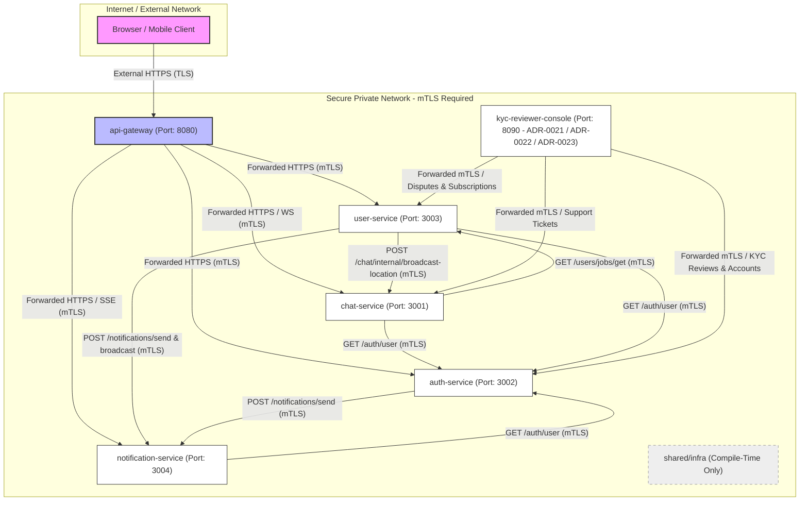

# Quick Delivery — Complete Application Map

> [!NOTE]
> **Reflects Repository State**: This document maps the application architecture, APIs, inter-service connections, and actor flows as of Git commit: **`3666f2b3`**.
> Since the codebase is subject to ongoing development, this map should be regenerated and re-verified via `git rev-parse --short HEAD` after significant routing or security changes.

---

## Connection Diagram

The following diagram visualizes the trust boundary and inter-service connections across the application. External client traffic enters solely through the API Gateway, which acts as the SSL-termination edge and proxies to internal services via mTLS.



---

## Section 1: Service Inventory

The platform is comprised of **5 microservices** and **1 compile-time shared package**. Below is the detailed inventory of each component, its database ownership, port mappings, and HTTP routing policies.

### 1. `api-gateway` (Port: `8080`)
* **Core Responsibility**: The public-facing reverse proxy and routing edge for all client-facing traffic. Terminates SSL/TLS on the internet boundary, enforces edge rate limiting via Redis, enforces minimum client version gating (`VersionGate` middleware), rewrites request paths, and strips unsafe incoming headers.
* **Database & Collections**: MongoDB (`platform_versions` for ADR-0018 client version gating configuration; in-memory fallback in local/test mode). Maintains edge rate limit buckets inside Redis.
* **Security & TLS Policy**: 
  * Inbound: Serves public traffic over HTTPS (`http.ListenAndServeTLS` using `EXTERNAL_TLS_CERT_PATH` and `EXTERNAL_TLS_KEY_PATH`).
  * Outbound: Calls downstream services using mTLS (`tlsutil.LoadClientTLSConfig`).
* **Header Handling**: 
  * Strips/deletes incoming `X-Internal-Token` headers from callers.
  * Overwrites `X-Forwarded-For` with the client’s remote address.
  * Injects `X-Gateway-Secret` to authenticate gateway-proxied requests.
* **Outbound HTTP Calls**:
  * `auth-service`: Matches prefix `/api/v1/auth/` and forwards to `http://auth-service:3002`.
  * `user-service`: Matches prefix `/api/v1/users/` and forwards to `http://user-service:3003`.
  * `chat-service`: Matches prefix `/api/v1/chat/` and forwards to `http://chat-service:3001`.
  * `notification-service`: Matches prefix `/api/v1/notifications/stream` and forwards to `http://notification-service:3004`.

### 2. `auth-service` (Port: `3002`)
* **Core Responsibility**: Manages user profiles, credentials, 2FA OTP codes, employee activations, session verification, and audit logs.
* **Database & Collections**: MongoDB (`auth_db`):
  * `users`: Stores emails, role types, hashed passwords (bcrypt), KYC states, suspension states, and OTP secrets.
  * `audit_logs`: Records simulated employee actions, reviewer suspensions/reactivations, and administrative tasks.
* **Security & TLS Policy**: Internal mTLS-only server.
* **Inbound HTTP calls**:
  * `api-gateway` (public routes).
  * `kyc-reviewer-console` (calls `/auth/kyb-kye/*`, `/auth/accounts*`, `/auth/reviewer/verify`, `/auth/documents/view`).
  * `chat-service` (calls `/auth/user` to authenticate WebSockets).
  * `notification-service` (calls `/auth/user` to authenticate SSE streams).
  * `user-service` (calls `/auth/user` to verify KYC status).
* **Outbound HTTP calls**: `notification-service` (invokes `/notifications/send` internally to dispatch KYC/KYB/KYE review and account suspension/reactivation notifications per ADR-0021/ADR-0022).

### 3. `chat-service` (Port: `3001`)
* **Core Responsibility**: Real-time communication server. Hosts WebSockets for active chat channels (segregated per job/ticket), manages location broadcasts, and coordinates support agent ticket assignments and ops ticket resolution.
* **Database & Collections**: MongoDB (`chat_db`):
  * `chat_messages`: Stores message history for channels.
  * `complaint_tickets`: Stores complaint ticket states, resolution notes, and assigned agents.
  * `support_agents`: Stores onboarded support agents and active session tokens.
* **Internal Handler Architecture (`internal/handlers/`)**:
  * `chat.go`: Service routes registration, WebSocket upgrade, channel authorization, and consumer ticket submission.
  * `admin_tickets.go`: Reviewer ticket oversight and CAS ticket resolution (`AdminListTickets`, `AdminResolveTicket` per ADR-0023 Module B).
* **Security & TLS Policy**: Serves mTLS HTTPS API routes and upgrades client WebSocket connections.
* **Inbound HTTP calls**:
  * `api-gateway` (public routes).
  * `kyc-reviewer-console` (calls `/admin/tickets` and `/admin/tickets/resolve`).
  * `user-service` (calls `/chat/internal/broadcast-location`).
* **Outbound HTTP calls**:
  * `auth-service`: Queries `/auth/user?id=<user_id>` to authenticate WebSocket connections, and `/auth/reviewer/verify` to verify reviewer tokens.
  * `user-service`: Queries `GET /users/jobs/get?id=<job_id>` to resolve job owner, employee, and customer relationships for channel access control.

### 4. `notification-service` (Port: `3004`)
* **Core Responsibility**: Real-time client alerts and durable in-app notifications hub. Streams real-time popups and tenant-wide job alerts to connected web/mobile clients via Server-Sent Events (SSE), persists durable MongoDB-backed notification history with 30-day TTL retention, maintains per-recipient read and dismiss tracking across single-recipient and role-broadcast notifications (isolated per recipient rather than a single shared flag), and exposes 5 authenticated REST endpoints for history, read marking, and deletion (`GET /notifications/history`, `POST /notifications/{id}/read`, `POST /notifications/read-all`, `DELETE /notifications/{id}`, `DELETE /notifications`).
* **Database & Collections**: MongoDB (`notification_db`):
  * `notifications`: Stores persisted notification documents with compound indexes on `(tenant_id, user_id, timestamp desc)` and `(tenant_id, roles, timestamp desc)`, a 30-day TTL expiration index on `created_at` (`expireAfterSeconds = 2592000`), and per-recipient tracking arrays (`read_by`, `dismissed_by`). SSE connections are held in-memory within the active Hub.
* **Security & TLS Policy**: Serves mTLS HTTPS API routes and maintains SSE streams.
* **Inbound HTTP calls**:
  * `api-gateway` (public `/notifications/stream` routes and REST endpoints).
  * `user-service` (invokes `/notifications/broadcast/job-alert` internally).
  * `auth-service` (invokes `/notifications/send` internally for KYC/KYB/KYE review outcome notifications per ADR-0021).
* **Outbound HTTP calls**:
  * `auth-service`: Queries `/auth/user?id=<user_id>` to verify connecting SSE client tokens and to read users' FCM device tokens; `POST /auth/device-token` (`unregister`) removes a token FCM reports as stale.
  * Google (only with an FCM service-account key): the key's `token_uri` (`oauth2.googleapis.com/token`) for an OAuth2 access token, then FCM HTTP v1 `fcm.googleapis.com/v1/projects/<project>/messages:send` (see "FCM push payload" below).

### 5. `user-service` (Port: `3003`)
* **Core Responsibility**: Manages the marketplace services directory (with spatial queries), active job lifecycles, wallets, ledgers, subscriptions, and provider ratings.
* **Database & Collections**: MongoDB (`user_db`):
  * `services`: Stores list of provider service listings with `2dsphere` coordinates.
  * `jobs`: Stores active jobs, statuses, tracking coordinates, and transaction references.
  * `wallets`: Stores tenant e-wallet balances (`total_balance`, `withdrawable_balance`).
  * `ledger`: Stores accounting journal entries for auditability.
  * `subscriptions`: Stores tenant subscription statuses and plans.
* **Internal Handler Architecture (`internal/handlers/`)**:
  * `handlers.go`: Service receiver struct (`UserService`), constructor (`NewUserService`), route registration (`RegisterRoutes`), and cross-domain shared utility helpers (`resolveClaims`, `resolveTokenWithRole`, `writeJSON`, `generateID`, `haversineKm`, `checkKYC`, `verifyEmployeeAssignment`, `requireTier`).
  * `services_handlers.go`: Service catalogue management and platform configuration (`ListServices`, `CreateService`, `UpdateService`, `GetPlatformConfig`).
  * `jobs_handlers.go`: Core job lifecycle, cascade dispatch, offer acceptance/decline, escrow locking/settlement, live location updates, and price negotiation (`TrackJob`, `AcceptJobOffer`, `DeclineJobOffer`, `HeartbeatLocation`, `CompleteJob`, `GetJob`, `GetOwnerJobs`, `GetCustomerJobs`, `UpdateJobLocation`, `CancelJob`, `ProposePrice`, `RespondPrice`).
  * `wallet_handlers.go`: Tenant balance, ledger audit trails, deposit bypass, and payout requests (`GetWallet`, `WalletDeposit`, `GetLedger`, `RequestPayout`, `GetPayoutRequests`).
  * `subscription_handlers.go`: Tenant subscription tier status and upgrade requests (`Subscription`).
  * `admin_subscription_handlers.go`: Reviewer subscription oversight, manual activation, and revocation (`AdminListSubscriptions`, `AdminActivateSubscription`, `AdminRevokeSubscription` per ADR-0023 Module A).
  * `ratings_handlers.go`: Blind rating submissions and aggregated score lookups (`RateJob`, `GetRatings`).
  * `reconciliation_handlers.go`: Disputed escrow reconciliation queue and resolution (`GetReconciliationQueue`, `ResolveReconciliation`, `AdminListReconciliationQueue`, `AdminResolveReconciliation` per ADR-0023 Module 1.1).
* **Security & TLS Policy**: Internal mTLS-only server.
* **Inbound HTTP calls**:
  * `api-gateway` (public routes).
  * `kyc-reviewer-console` (calls `/admin/reconciliation/*` and `/admin/subscriptions*`).
  * `chat-service` (queries `/users/jobs/get?id=<job_id>`).
* **Outbound HTTP calls**:
  * `auth-service`: Queries `/auth/user?id=<owner_id>` to verify owner KYC status, and `/auth/reviewer/verify` to verify reviewer tokens.
  * `chat-service`: Queries `POST /chat/internal/broadcast-location` to publish live driver coordinates.
  * `notification-service`: Dispatches real-time courier acceptance and cascade exhaustion alerts via `POST /notifications/send`, and broadcasts tenant job notifications via `POST /notifications/broadcast/job-alert`.

### 6. `shared/infra` (Compile-time dependency)
* **Core Responsibility**: Consolidates common code dependencies (saving duplicate lines in monorepo).
* **Libraries**:
  * `jwtutil`: Validates/generates signed JWT credentials.
  * `ratelimit`: Redis-backed sliding-window rate limiters.
  * `resilience`: Circuit breakers (`gobreaker`) and retries.
  * `tlsutil`: Configures internal mTLS handshakes.
  * `handlerutil`: Ships structured logs and security events.

---

## Section 2: Complete Endpoint Table

All HTTP endpoints registered across the services are listed below, cross-referenced with their actual routing definitions.

> [!NOTE]
> **Request Parameter Naming Compatibility**: To address naming clarity issues where request fields expected signed JWT tokens rather than raw database IDs, the Go backend supports newer `_token` aliases alongside legacy parameter names (preferring `_token` if both are present).
> 
> | Legacy Field Name | New Preferred Alias | Affected Endpoints |
> |---|---|---|
> | `user_id` / `id` | `user_token` | GET /auth/user, GET /auth/user/public-profile, POST /users/jobs/track, GET /users/ratings |
> | `owner_id` | `owner_token` | POST /users/services, POST /users/jobs/track |
> | `employee_id` | `employee_token` | POST /users/jobs/track, GET /users/jobs/get |
> | `requester_id` | `requester_token` | GET /auth/audit-log, GET /auth/user/public-profile, GET /users/jobs/get, POST /users/jobs/complete, POST /users/jobs/cancel, POST /users/subscription, POST /users/jobs/location/update |
> | `tenant_id` | `tenant_token` | GET /users/wallet, POST /users/wallet/deposit, GET /users/ledger, GET /users/subscription, POST /users/subscription |
> | `rated_by` / `rated_user` | `rated_by_token` / `rated_user_token` | POST /users/jobs/rate |

<!-- GENERATED:ENDPOINTS:START -->
| Method + Path | Owning Service | Caller Permissions | Core Functionality | Read / Write Target & Downstream Actions |
| :--- | :--- | :--- | :--- | :--- |
| **`GET /`** | `api-gateway` | Public | Root index. | None. |
| **`GET /api/v1/admin/version-config`** | `api-gateway` | `X-Admin-Token` | Fetches current mobile client minimum and latest version enforcement configuration. | Reads in-memory version store. |
| **`PUT /api/v1/admin/version-config`** | `api-gateway` | `X-Admin-Token` | Updates mobile client minimum and latest version enforcement configuration. | Updates in-memory version store. |
| **`GET /health`** | `api-gateway` | Public | Public gateway health status. | None. |
| **`GET /health/internal`** | `api-gateway` | `X-Internal-Token` | Returns circuit breaker metrics. | Reads breaker memory. |
| **`GET /auth/accounts`** | `auth-service` | Reviewer Token & `X-Internal-Token` | Searches and lists registered accounts with pagination, role and status filters (ADR-0022). | Reads `users` collection. |
| **`POST /auth/accounts/reactivate`** | `auth-service` | Reviewer Token & `X-Internal-Token` | Reactivates a suspended user account with optional reason and dispatches notification (ADR-0022). | Updates `users` collection. Writes `audit_log`. |
| **`POST /auth/accounts/suspend`** | `auth-service` | Reviewer Token & `X-Internal-Token` | Suspends a user account with mandatory reason, revoking active JWT sessions and dispatching notification (ADR-0022). | Updates `users` collection. Writes `audit_log`. Invalidates Redis JWT tokens. |
| **`POST /auth/accounts/{id}/reactivate`** | `auth-service` | Reviewer Token & `X-Internal-Token` | Reactivates a suspended user account with optional reason and dispatches notification (ADR-0022). | Updates `users` collection. Writes `audit_log`. |
| **`POST /auth/accounts/{id}/suspend`** | `auth-service` | Reviewer Token & `X-Internal-Token` | Suspends a user account with mandatory reason, revoking active JWT sessions and dispatching notification (ADR-0022). | Updates `users` collection. Writes `audit_log`. Invalidates Redis JWT tokens. |
| **`GET /auth/audit-log`** | `auth-service` | Tenant Owner JWT | Fetches tenant security audit logs. Accepts requester_id (legacy) or requester_token (preferred). | Reads `audit_logs` collection. |
| **`DELETE /auth/device-token`** | `auth-service` | Authenticated User JWT | Unregisters client push notification device token. | Updates `users` collection (`device_tokens`). |
| **`GET /auth/documents/view`** | `auth-service` | Reviewer Token & `X-Internal-Token` | Validates signed URL token and streams/serves the uploaded document file. | Streams file content. |
| **`POST /auth/email-change/confirm`** | `auth-service` | Authenticated User JWT | Verifies OTP and commits updated email address to user profile, issuing fresh JWT. | Updates `users` collection, clears pending change, issues new JWT. |
| **`POST /auth/email-change/request`** | `auth-service` | Authenticated User JWT | Initiates email change request, validates format and availability, and dispatches OTP to new email. | Writes `pending_email_changes` in `users` collection, dispatches OTP. |
| **`POST /auth/employee/action`** | `auth-service` | Target Employee JWT | Records a simulated worker activity. | Writes `audit_logs` collection. |
| **`POST /auth/employee/toggle`** | `auth-service` | Owner JWT (KYC Approved) | Activates/deactivates employee account. | Reads `users` (owner/employee), updates `users`. |
| **`GET /auth/employees`** | `auth-service` | Owner JWT | GetEmployees returns all employees registered under the caller's tenant owner account. | Reads `users` collection by `tenant_id`. Returns JSON array of `EmployeeResponse` (`ID`, `Username`, `Email`, `IsActive`, `CreatedAt`). Rate-limited per owner ID. |
| **`POST /auth/forgot-password`** | `auth-service` | Public | Dispatches password reset OTP code if account exists. | Reads `users` collection by email, updates `otp_code` and `otp_expires_at` fields. |
| **`GET /auth/internal/overview-stats`** | `auth-service` | `X-Internal-Token` | Returns counts for pending KYB/KYE, accounts created today/7d, and suspended accounts for admin console aggregation. | Reads `users` collection. |
| **`GET /auth/kyb-kye/pending`** | `auth-service` | Reviewer Token & `X-Internal-Token` | Fetches pending KYB verification submissions (including username). | Reads `users` and `reviewers` collections. |
| **`POST /auth/kyb-kye/review`** | `auth-service` | Reviewer Token & `X-Internal-Token` | Approves or rejects KYB submissions. | Updates `users` status. Writes `audit_logs` and `reviewers`. |
| **`GET /auth/kyb-kye/user-documents`** | `auth-service` | Reviewer Token & `X-Internal-Token` | Alias for /auth/reviewer/user-documents; retrieves signed URLs for user KYC/KYE documents. | Reads `users` collection. Writes `audit_logs` (`DOCUMENT_VIEWED`, `USER_DOCUMENTS_RETRIEVED`). |
| **`POST /auth/kyb/upload`** | `auth-service` | Owner JWT | Uploads KYB verification files (ID front/back, selfie, business proof). | Writes uploaded documents to local storage. Updates `users` collection. |
| **`POST /auth/kye/upload`** | `auth-service` | Employee JWT | Uploads KYE verification files (ID front/back, selfie). | Writes uploaded documents to local storage. Updates `users` collection. |
| **`POST /auth/login`** | `auth-service` | Public (via Gateway) | Logs in user, dispatches 2FA OTP. | Reads/writes `users` collection (OTP/attempts). Writes `audit_logs`. |
| **`POST /auth/logout`** | `auth-service` | Bearer JWT | Logs out user, revokes JWT session. | Writes token JTI to Redis denylist. |
| **`POST /auth/refresh`** | `auth-service` | Public (via Gateway) | Refreshes active JWT sessions. | None. |
| **`POST /auth/resend-otp`** | `auth-service` | Public | ResendOTP handles resending a fresh OTP for unconfirmed accounts. | Reads `users` collection by email, updates `otp_code` and `otp_expires_at` fields. |
| **`POST /auth/reset-password`** | `auth-service` | Public | Sets a new password presenting the single-use phase-2 reset token minted by verify-code (email alone is never sufficient). | Reads `users` collection by email, verifies token digest + expiry, updates `password` hash and clears token/OTP fields. |
| **`POST /auth/reset-password/verify-code`** | `auth-service` | Public | VerifyResetCode validates a password-reset OTP code and mints a single-use phase-2 reset token (returned raw once; only its hash is stored). Issues no session. | Reads `users` collection by email, atomically consumes `otp_code`, sets `otp_verified` + `reset_token_hash`/`reset_token_expires_at`. Dual-keyed rate limiting on client IP + email. |
| **`GET /auth/reviewer/user-documents`** | `auth-service` | Reviewer Token & `X-Internal-Token` | Retrieves fresh signed URLs for all KYC/KYE documents for a user with mandatory audit reason. | Reads `users` collection. Writes `audit_logs` (`DOCUMENT_VIEWED`, `USER_DOCUMENTS_RETRIEVED`). |
| **`GET /auth/reviewer/verify`** | `auth-service` | Reviewer Token & `X-Internal-Token` | Verifies reviewer credentials and returns reviewer identity for inter-service ops authentication (ADR-0023). | Reads `reviewers` collection. |
| **`POST /auth/signup`** | `auth-service` | Public (via Gateway) | Registers a new tenant or user. | Writes `users` collection. Logs OTP code. |
| **`GET /auth/user`** | `auth-service` | `X-Internal-Token` OR User JWT | Resolves user profile (including username) and role details. Accepts id (legacy) or user_token (preferred). | Reads `users` collection. |
| **`PATCH /auth/user`** | `auth-service` | Authenticated User JWT | Self-service profile update (username, phone, frequent_addresses, saved_addresses) with IDOR protection. | Updates `users` collection. |
| **`PUT /auth/user`** | `auth-service` | Authenticated User JWT | Self-service profile update (username, phone, frequent_addresses, saved_addresses) with IDOR protection. | Updates `users` collection. |
| **`GET /auth/user/public-profile`** | `auth-service` | User JWT | Returns only non-sensitive, public profile fields (ID and username). Accepts id (legacy) or user_token (preferred), and requester_id (legacy) or requester_token (preferred). | Reads `users` collection. |
| **`POST /auth/verify-otp`** | `auth-service` | Public (via Gateway) | Validates 2FA OTP, issues JWT. | Reads/writes `users` collection. Writes `audit_logs`. |
| **`GET /admin/tickets`** | `chat-service` | Reviewer Token & `X-Internal-Token` | Lists all support tickets globally for ops console oversight (ADR-0023). | Reads `complaint_tickets` collection. Paginated. |
| **`POST /admin/tickets/accept`** | `chat-service` | Reviewer Token & `X-Internal-Token` | Atomically assigns a pending ticket to a reviewer (CAS) and dispatches customer notification. | CAS updates `complaint_tickets` and dispatches notification via notification-service. |
| **`POST /admin/tickets/resolve`** | `chat-service` | Reviewer Token & `X-Internal-Token` | Resolves support ticket globally with mandatory resolution note (ADR-0023). | CAS updates `complaint_tickets` and releases assigned agent. |
| **`GET /attachments/view`** | `chat-service` | Signed URL Token with live ticket participant access | Alias for /chat/attachments/view; streams decrypted attachment file. | Reads `complaint_tickets` collection. Streams decrypted file content. |
| **`GET /chat/admin/tickets`** | `chat-service` | Reviewer Token & `X-Internal-Token` | Lists all support tickets globally for ops console oversight (ADR-0023). | Reads `complaint_tickets` collection. Paginated. |
| **`POST /chat/admin/tickets/accept`** | `chat-service` | Reviewer Token & `X-Internal-Token` | Atomically assigns a pending ticket to a reviewer (CAS) and dispatches customer notification. | CAS updates `complaint_tickets` and dispatches notification via notification-service. |
| **`POST /chat/admin/tickets/resolve`** | `chat-service` | Reviewer Token & `X-Internal-Token` | Resolves support ticket globally with mandatory resolution note (ADR-0023). | CAS updates `complaint_tickets` and releases assigned agent. |
| **`GET /chat/attachments/view`** | `chat-service` | Signed URL Token with live ticket participant access | Validates signed token claims and re-verifies live ticket access before streaming decrypted attachment. | Reads `complaint_tickets` collection. Streams decrypted file content. |
| **`GET /chat/history`** | `chat-service` | Channel Member JWT | Retrieves channel chat history (containing sender_username point-in-time snapshot). | Reads `chat_messages` collection. Downstream: calls `user-service/users/jobs/get`. |
| **`POST /chat/internal/broadcast-location`** | `chat-service` | `X-Internal-Token` | Broadcasts driver location event. | None. |
| **`GET /chat/internal/overview-stats`** | `chat-service` | `X-Internal-Token` | Returns counts for open and assigned tickets for admin console aggregation. | Reads `complaint_tickets` collection. |
| **`POST /chat/tickets`** | `chat-service` | User JWT | Submits complaint ticket in pending status for reviewer pickup. | Writes `complaint_tickets` collection. |
| **`POST /chat/tickets/attachment`** | `chat-service` | Ticket Participant JWT OR Reviewer Token | Uploads and encrypts file attachment for support ticket chat with ticket_id form field. | Writes encrypted attachment to local storage. Persists message in `chat_messages`. Broadcasts to WebSocket channel. |
| **`GET /chat/tickets/mine`** | `chat-service` | User JWT | Lists support tickets submitted by the authenticated customer, sorted newest first. | Queries `complaint_tickets` collection by `customer_id`. Paginated. |
| **`POST /chat/tickets/{id}/attachment`** | `chat-service` | Ticket Participant JWT OR Reviewer Token | Uploads and encrypts file attachment for support ticket chat (JPEG, PNG, PDF up to 10MB). | Writes encrypted attachment to local storage. Persists message in `chat_messages`. Broadcasts to WebSocket channel. |
| **`GET /chat/ws`** | `chat-service` | User JWT OR Agent Token | WebSocket connection upgrade path. | Reads `support_agents` (for agent tokens). Downstream: calls `auth-service/auth/user`. |
| **`POST /tickets/attachment`** | `chat-service` | Ticket Participant JWT OR Reviewer Token | Alias for /chat/tickets/attachment; uploads file attachment for support ticket chat. | Writes encrypted attachment to local storage. Persists message in `chat_messages`. Broadcasts to WebSocket channel. |
| **`GET /tickets/mine`** | `chat-service` | User JWT | Lists support tickets submitted by the authenticated customer, sorted newest first. | Queries `complaint_tickets` collection by `customer_id`. Paginated. |
| **`POST /tickets/{id}/attachment`** | `chat-service` | Ticket Participant JWT OR Reviewer Token | Alias for /chat/tickets/{id}/attachment; uploads file attachment for support ticket chat. | Writes encrypted attachment to local storage. Persists message in `chat_messages`. Broadcasts to WebSocket channel. |
| **`POST /notifications/broadcast/job-alert`** | `notification-service` | `X-Internal-Token` | Broadcasts job alert to employees. | Dispatches message to SSE clients. |
| **`GET /notifications/history`** | `notification-service` | User JWT | Returns the authenticated user's persisted notifications, paginated. | Reads `notifications` collection. |
| **`POST /notifications/read-all`** | `notification-service` | User JWT | Marks all notifications as read for the authenticated user. | Updates `notifications` collection. |
| **`POST /notifications/send`** | `notification-service` | `X-Internal-Token` | Sends a targeted popup alert. | Dispatches message to SSE client. |
| **`GET /notifications/stream`** | `notification-service` | User JWT | Opens SSE channel for alerts. | Downstream: calls `auth-service/auth/user`. |
| **`DELETE /notifications/{id}`** | `notification-service` | User JWT | Deletes a single notification for the authenticated user. | Deletes from `notifications` collection. |
| **`POST /notifications/{id}/read`** | `notification-service` | User JWT | Marks a single notification as read for the authenticated user. | Updates `notifications` collection. |
| **`GET /admin/overview`** | `user-service` | Reviewer Token & `X-Internal-Token` | Returns aggregated metrics across user-service (subscriptions, GPS disputes, stuck COD jobs, jobs today) and calls auth/chat services with resilient fallbacks. | Reads `subscriptions` and `jobs` collections, calls `auth-service` and `chat-service` internal overview endpoints. Ships security audit event. |
| **`GET /admin/payouts`** | `user-service` | Reviewer Token & `X-Internal-Token` | Lists payout requests across all tenants with optional status filter and pagination for ops console oversight. | Reads `payout_requests` collection. Paginated. |
| **`POST /admin/payouts/reject`** | `user-service` | Reviewer Token & `X-Internal-Token` | Rejects a requested payout with mandatory reason, restores wallet balance, and writes compensation ledger entry. | CAS status transition on `payout_requests`, updates `wallets`, writes `ledger`, ships security audit event. |
| **`GET /admin/reconciliation/queue`** | `user-service` | Reviewer Token & `X-Internal-Token` | Lists all jobs in escrow_reconciliation_required status globally across all tenants for ops console oversight (ADR-0023). | Reads `jobs` collection. Paginated. |
| **`POST /admin/reconciliation/resolve`** | `user-service` | Reviewer Token & `X-Internal-Token` | Resolves disputed job in escrow_reconciliation_required status globally via ops reviewer override with mandatory reason (ADR-0023). | CAS status transition on `jobs`, financial settlement/refund, ships security audit event and dispatches notifications. |
| **`GET /admin/subscriptions`** | `user-service` | Reviewer Token & `X-Internal-Token` | Lists subscriptions globally with optional status/search filters and pagination for ops console oversight (ADR-0023). | Reads `subscriptions` collection. Paginated. |
| **`POST /admin/subscriptions/activate`** | `user-service` | Reviewer Token & `X-Internal-Token` | Activates tenant subscription to PlanPaid with configurable duration (ADR-0023). | CAS status transition on `subscriptions` collection, ships security audit event. |
| **`GET /admin/subscriptions/queue`** | `user-service` | Reviewer Token & `X-Internal-Token` | Lists subscriptions globally with optional status/search filters and pagination for ops console oversight (ADR-0023). | Reads `subscriptions` collection. Paginated. |
| **`POST /admin/subscriptions/revoke`** | `user-service` | Reviewer Token & `X-Internal-Token` | Revokes tenant subscription to PlanCancelled with mandatory reason (ADR-0023). | CAS status transition on `subscriptions` collection, ships security audit event. |
| **`GET /users/admin/overview`** | `user-service` | Reviewer Token & `X-Internal-Token` | Alias for /admin/overview; returns aggregated platform overview metrics for admin console. | Reads `subscriptions` and `jobs` collections, calls `auth-service` and `chat-service` internal overview endpoints. Ships security audit event. |
| **`GET /users/admin/payouts`** | `user-service` | Reviewer Token & `X-Internal-Token` | Lists payout requests across all tenants with optional status filter and pagination for ops console oversight. | Reads `payout_requests` collection. Paginated. |
| **`POST /users/admin/payouts/reject`** | `user-service` | Reviewer Token & `X-Internal-Token` | Rejects a requested payout with mandatory reason, restores wallet balance, and writes compensation ledger entry. | CAS status transition on `payout_requests`, updates `wallets`, writes `ledger`, ships security audit event. |
| **`GET /users/admin/reconciliation/queue`** | `user-service` | Reviewer Token & `X-Internal-Token` | Lists all jobs in escrow_reconciliation_required status globally across all tenants for ops console oversight (ADR-0023). | Reads `jobs` collection. Paginated. |
| **`POST /users/admin/reconciliation/resolve`** | `user-service` | Reviewer Token & `X-Internal-Token` | Resolves disputed job in escrow_reconciliation_required status globally via ops reviewer override with mandatory reason (ADR-0023). | CAS status transition on `jobs`, financial settlement/refund, ships security audit event and dispatches notifications. |
| **`GET /users/admin/subscriptions`** | `user-service` | Reviewer Token & `X-Internal-Token` | Lists subscriptions globally with optional status/search filters and pagination for ops console oversight (ADR-0023). | Reads `subscriptions` collection. Paginated. |
| **`POST /users/admin/subscriptions/activate`** | `user-service` | Reviewer Token & `X-Internal-Token` | Activates tenant subscription to PlanPaid with configurable duration (ADR-0023). | CAS status transition on `subscriptions` collection, ships security audit event. |
| **`POST /users/admin/subscriptions/revoke`** | `user-service` | Reviewer Token & `X-Internal-Token` | Revokes tenant subscription to PlanCancelled with mandatory reason (ADR-0023). | CAS status transition on `subscriptions` collection, ships security audit event. |
| **`POST /users/employee/jobs/accept`** | `user-service` | Employee JWT | Accepts an active dispatch offer, calculates final distance pricing from courier location, and activates job. | Updates `jobs` collection, updates `wallets` (for escrow locking), dispatches notification. |
| **`POST /users/employee/jobs/decline`** | `user-service` | Employee JWT | Declines an active dispatch offer and advances the cascade immediately to the next courier. | Updates `jobs` collection, queries `employee_locations`, dispatches next offer notification. |
| **`POST /users/employee/jobs/{id}/accept`** | `user-service` | Employee JWT | Accepts an active dispatch offer, calculates final distance pricing from courier location, and activates job. | Updates `jobs` collection, updates `wallets` (for escrow locking), dispatches notification. |
| **`POST /users/employee/jobs/{id}/decline`** | `user-service` | Employee JWT | Declines an active dispatch offer and advances the cascade immediately to the next courier. | Updates `jobs` collection, queries `employee_locations`, dispatches next offer notification. |
| **`POST /users/employee/location`** | `user-service` | Employee JWT | Updates employee standalone availability GPS coordinates and heartbeat for proximity-based cascade dispatch. | Updates `employee_locations` collection and Redis geo cache. |
| **`GET /users/employees/available`** | `user-service` | Owner, Customer, or Employee JWT / Internal Service Token | GetAvailableEmployees returns active, available employee location records for a tenant updated within the freshness window. | Queries `employee_locations` collection by `tenant_id` and freshness threshold. |
| **`POST /users/jobs/cancel`** | `user-service` | Owner or Customer JWT (employee role removed per ADR-0027) | Cancels an active job and processes escrow refunds. Accepts requester_id (legacy) or requester_token (preferred). | Updates `jobs` collection. Updates `wallets` and `ledger` collections. |
| **`POST /users/jobs/complete`** | `user-service` | Owner or Employee JWT | Completes active job, processes fees. Accepts requester_id (legacy) or requester_token (preferred) in body or query. | Updates `jobs`, writes `wallets`, writes `ledger`. |
| **`GET /users/jobs/get`** | `user-service` | `X-Internal-Token` OR Owner, Employee, User, or Customer JWT | Resolves detailed job configuration (single job by ID) or lists jobs. Accepts id (legacy) or user_token (preferred), requester_id (legacy) or requester_token (preferred), and employee_id (legacy) or employee_token (preferred). | Reads `jobs` collection. Enforces IDOR protection: if `employee_id` query param is provided, it must match the employee identity strictly resolved from the JWT token. |
| **`POST /users/jobs/location/update`** | `user-service` | Employee or Owner JWT | Updates driver coordinates. Accepts requester_id (legacy) or requester_token (preferred). | Reads `jobs`, updates `jobs`. Downstream: calls `chat-service/chat/internal/broadcast-location`. |
| **`GET /users/jobs/mine`** | `user-service` | Customer JWT | Lists all jobs booked by the authenticated customer (DTO: CustomerJobResponse). Supports optional user_id parameter matching for IDOR validation. | Reads `jobs` collection. Rate-limited per customer identity (30 req/min). |
| **`GET /users/jobs/owner`** | `user-service` | Owner JWT | Lists all jobs owned by the authenticated tenant owner (DTO: OwnerJobResponse). Supports optional owner_id parameter matching for IDOR validation. | Reads `jobs` collection. Rate-limited per owner identity (30 req/min). |
| **`POST /users/jobs/pickup`** | `user-service` | Public | POST /users/jobs/pickup (ADR-0028 §2.9): the assigned courier confirms | <!-- TODO: verify manually --> |
| **`POST /users/jobs/propose-price`** | `user-service` | Customer or Employee JWT | ProposePrice proposes a custom price for a negotiable transport job. | Reads services and jobs, updates proposed_price, proposed_by, proposal_expires_at, and job status. |
| **`POST /users/jobs/rate`** | `user-service` | Owner, Employee, User, or Customer JWT | Submits a double-blind rating. Accepts rated_by (legacy) or rated_by_token (preferred), and rated_user (legacy) or rated_user_token (preferred). | Writes `ratings`, updates `jobs`. |
| **`GET /users/jobs/reconciliation-queue`** | `user-service` | Owner JWT | Lists all jobs in escrow_reconciliation_required status for the authenticated tenant owner. | Reads `jobs` collection. Scoped to authenticated owner ID with IDOR validation and rate-limiting (30 req/min). |
| **`POST /users/jobs/reconciliation-resolve`** | `user-service` | Owner JWT | Resolves job in escrow_reconciliation_required status ('release_to_employee' or 'refund_to_customer'). | Updates `jobs` status and reconciliation fields, writes `wallets` and `ledger`, ships security audit event. |
| **`POST /users/jobs/request-cancellation`** | `user-service` | Employee JWT (assigned employee only) | RequestCancellation submits an employee cancellation request for owner approval; job status is unchanged. | Updates `jobs` cancellation_request_* fields. Dispatches owner notification. |
| **`POST /users/jobs/respond-cancellation`** | `user-service` | Owner JWT (job owner only) | RespondCancellation accepts (cancels via the shared CancelJob implementation) or declines a pending employee cancellation request. | Updates `jobs` collection (CAS on pending), `wallets`/`ledger` on accept, dispatches employee notification. |
| **`POST /users/jobs/respond-price`** | `user-service` | Customer or Employee JWT | RespondPrice accepts or declines a price proposal for a transport job. | Updates jobs agreed_price, status (active or cancelled), and cancellation_reason. |
| **`POST /users/jobs/track`** | `user-service` | Owner/Employee JWT (legacy tracking) OR Customer JWT + service_id (owner resolved server-side; supports optional employee pre-assignment) | Books job with coordinate validation. Accepts user_id (legacy) or user_token (preferred), owner_id (legacy) or owner_token (preferred), and employee_id (legacy) or employee_token (preferred). | Downstream: calls `auth-service/auth/user`. Writes `jobs`. |
| **`GET /users/ledger`** | `user-service` | Owner JWT | Lists financial ledger records. Accepts tenant_id (legacy) or tenant_token (preferred). | Reads `ledger` collection. |
| **`GET /users/platform/config`** | `user-service` | Public | Fetches global fees configuration. | Reads `platform_config` collection. |
| **`GET /users/ratings`** | `user-service` | Owner, Employee, User, or Customer JWT | Returns ratings count and average. Accepts user_id (legacy) or user_token (preferred). | Reads `ratings` collection. |
| **`GET /users/services`** | `user-service` | Public | Spatial search on services directory. | Reads `services` collection. |
| **`PATCH /users/services`** | `user-service` | Owner JWT (KYC Approved) | Updates an existing service listing (photo, address, working hours, coverage radius, prices, category). | Downstream: calls `auth-service/auth/user`. Updates `services` collection. |
| **`POST /users/services`** | `user-service` | Owner JWT (KYC Approved) | Inserts service listing. | Downstream: calls `auth-service/auth/user`. Writes `services` collection. |
| **`PUT /users/services`** | `user-service` | Owner JWT (KYC Approved) | Updates an existing service listing (photo, address, working hours, coverage radius, prices, category). | Downstream: calls `auth-service/auth/user`. Updates `services` collection. |
| **`GET /users/services/`** | `user-service` | Public | <!-- TODO: verify manually --> | <!-- TODO: verify manually --> |
| **`POST /users/services/`** | `user-service` | Public | <!-- TODO: verify manually --> | <!-- TODO: verify manually --> |
| **`GET /users/services/photo`** | `user-service` | Public | <!-- TODO: verify manually --> | <!-- TODO: verify manually --> |
| **`POST /users/services/photo`** | `user-service` | Public | <!-- TODO: verify manually --> | <!-- TODO: verify manually --> |
| **`PATCH /users/services/update`** | `user-service` | Owner JWT (KYC Approved) | Updates an existing service listing (photo, address, working hours, coverage radius, prices, category). | Downstream: calls `auth-service/auth/user`. Updates `services` collection. |
| **`POST /users/services/update`** | `user-service` | Owner JWT (KYC Approved) | Updates an existing service listing (photo, address, working hours, coverage radius, prices, category). | Downstream: calls `auth-service/auth/user`. Updates `services` collection. |
| **`PUT /users/services/update`** | `user-service` | Owner JWT (KYC Approved) | Updates an existing service listing (photo, address, working hours, coverage radius, prices, category). | Downstream: calls `auth-service/auth/user`. Updates `services` collection. |
| **`POST /users/subscription`** | `user-service` | Owner JWT (KYC Approved) | Subscribes/renews SaaS tier. Accepts tenant_id (legacy) or tenant_token (preferred), and requester_id (legacy) or requester_token (preferred). | Updates `subscriptions`, writes `wallets`, writes `ledger`. |
| **`GET /users/subscription/internal`** | `user-service` | `X-Internal-Token` | InternalSubscriptionCheck allows internal services (e.g., auth-service) to verify tenant active subscription tier. | Reads `subscriptions` collection in `user_db`. |
| **`GET /users/wallet`** | `user-service` | Owner JWT | Fetches active balance details. Accepts tenant_id (legacy) or tenant_token (preferred). | Reads `wallets` collection. |
| **`POST /users/wallet/deposit`** | `user-service` | Owner JWT | Loads funds up to maximum limits. Accepts tenant_id (legacy) or tenant_token (preferred). | Updates `wallets` collection. |
| **`POST /users/wallet/payout/request`** | `user-service` | Owner JWT | Processes a tenant owner withdrawal request for electronic wallet balance. | Reads `wallets` collection, writes `payout_requests` collection. |
| **`GET /users/wallet/payout/requests`** | `user-service` | Owner JWT | Retrieves historical payout requests for authenticated tenant owner. | Reads `payout_requests` collection. |
<!-- GENERATED:ENDPOINTS:END -->

### Contract notes: job events, stable codes, service photos (BE-GAPS-FIX)

Hand-written (the table above is generated). Details and the corrected USER-AUTH-BE claims: ADR-0028, Implementation Notes.

* **Job notification events** (`POST /notifications/send` from user-service; SSE `GET /notifications/stream`, `GET /notifications/history`, FCM data). `type` is the stable event; every notification about one job carries `job_id` and `event_type` (same value as `type`, derived by notification-service, so older history items have it too). Notifications without a job carry no `event_type`.

  | `type` | Sent when | Recipient |
  | :--- | :--- | :--- |
  | `job_booked` | `POST /users/jobs/track` creates the job (any initial status) | owner |
  | `job_offer` | cascade offers the job to a courier | that courier |
  | `job_alert` | booking pre-assigned to a courier (`/notifications/broadcast/job-alert`) | that courier (history: tenant roles) |
  | `job_accepted` | courier accepts | customer |
  | `job_picked_up` | `POST /users/jobs/pickup` (this is the on-the-way state: there is no separate in-transit step and no `job_in_transit`) | customer |
  | `job_delivered` | `POST /users/jobs/complete` succeeds (COD or escrow) | customer |
  | `job_cancelled` | the job is cancelled by the owner, an approved courier cancellation request, or the system (escrow lock failure); not when the customer cancels it themselves | customer |
  | `job_unavailable` | no courier available | customer |
  | `cancellation_requested`, `cancellation_request_expired`, `cancellation_resolved`, `dispute_resolved` | ADR-0027 / reconciliation | owner / courier / parties |

* **FCM push payload** (PUSH-BE). Every notification that reaches a user with registered device tokens is also sent as an FCM HTTP v1 message:

  | Field | Value |
  | :--- | :--- |
  | `notification.title` / `notification.body` | the template text in the device token's language (PUSH-L10N, below), else the notification's title and body |
  | `data.type` | the stable event (table above); always present |
  | `data.job_id`, `data.event_type` | job notifications only (strings; `event_type` = `type`) |
  | `data.id`, `data.tenant_id` | the notification ID and tenant |
  | `android.priority` | `HIGH` |
  | `android.notification.channel_id` | `qd_default`: the app must create an Android notification channel with this id |

  All `data` values are strings. A token FCM answers `UNREGISTERED` / `NOT_FOUND` for, or `INVALID_ARGUMENT` naming the token, is unregistered from the user; `429`/`5xx` are retried at most twice with backoff. Through an internal relay (`FCM_ENDPOINT_URL`) the message has no `android` block and no OAuth token.
* **Push language** (PUSH-L10N). Backward compatible: every new field is optional.
  * `POST /auth/device-token` takes `locale`: `"ar"` or `"en"` (`ar_EG`, `en-US` and any case are normalized; anything else is `400 {"error": "invalid locale: must be one of ar, en"}`). It is stored on that token only (`device_tokens[].locale`), so one user can have an Arabic phone and an English tablet. A registration without `locale` (1.x / 2.0.0 builds without PUSH-L10N) stores none, and removes one stored earlier for that token. The internal `GET /auth/user` returns it per token (no key when absent).
  * `POST /notifications/send` takes `params`: a string map of named template values (at most 16, else `400`). `variant` picks a variant of the type's text and is never shown; money values are plain decimals (`"1250.50"`).
  * Push text: for each token, notification-service renders the template of `type` (+ `variant`) in the token's locale with `params` (`services/notification-service/internal/templates/templates.go`, one table, the source of truth). The sender's `title` / `body` are pushed instead when the token has no locale, the type or variant has no template, or a parameter it needs is missing or blank. Money is `EGP 1,250.50` / `1,250.50 ج.م` (Western digits, thousands separator, no decimals for whole amounts), never `$`.
  * The stored notification keeps `params`; `GET /notifications/history` items and SSE events add `params` (when sent) and `texts: {"ar": {"title", "body"}, "en": {"title", "body"}}` (when the template renders). `title` / `body` stay the sender's English text.

  | `type` (`:variant`) | `params` | Sender |
  | :--- | :--- | :--- |
  | `job_accepted`, `job_accepted:negotiable` | `fare` (money) | user-service |
  | `job_cancelled`, `job_cancelled:escrow_failed` | none | user-service |
  | `job_unavailable`, `job_picked_up`, `job_delivered`, `job_booked`, `job_offer`, `cancellation_request_expired` | none | user-service |
  | `cancellation_requested` | `reason` | user-service |
  | `cancellation_resolved:accept`, `cancellation_resolved:decline` | none | user-service |
  | `dispute_resolved:customer_release`, `:customer_refund`, `:provider_release`, `:provider_refund` | none | user-service |
  | `job_alert` | `service_name` | notification-service (`/notifications/broadcast/job-alert`) |
  | `kyc_approved`, `account_reactivated` | none | auth-service |
  | `kyc_rejected`, `account_suspended` | `reason` | auth-service |
  | `ticket_resolved` | `ticket_id`, `note` | chat-service |
  | `ticket_assigned`, `ticket_assigned:anonymous` | `ticket_id`, `agent_name` (not with `anonymous`) | chat-service |

  No payout notification is sent today, so there is no payout template.
* **`POST /users/jobs/pickup`**: losing the pickup race (the job left `heading_to_pickup` between the read and the update) is `409 {"error": "job state changed during pickup", "message": ..., "code": "job_state_changed"}`. Other pickup codes: `job_id_required`, `unauthorized`, `role_mismatch`, `job_not_found`, `job_not_active`, `access_denied`, `already_picked_up`.
* **`POST /users/jobs/track`**: recipient, package and address text fields are optional (ADR-0028 §2.1, §2.2, §2.7). Field codes: `address_too_long`, `address_note_too_long`, `recipient_name_too_long`, `recipient_phone_invalid`, `recipient_notes_too_long`, `package_size_invalid`, `package_notes_too_long`. No `*_required` code is sent.
* **Service photo storage unavailable**: `POST /users/services/photo` (and `/{id}/photo`) and `GET /users/services/photo` answer `503 {"error": "photo storage unavailable", "code": "photo_storage_unavailable"}` when storage was never initialized or a write fails.
* **Service photo caching** (PUSH-BE): `GET /users/services/{id}/photo` (and `?key=`) answers `ETag: "<photo_version>"`, `Cache-Control: private, max-age=300`, and `304` with no body on a matching `If-None-Match`. Service JSON (single service and the priced list) and the upload response carry `photo_version` (16 hex characters derived from the storage key, absent without a photo); it changes on every new upload, so the app can request `.../photo?v=<photo_version>` to bypass its cache.
* **`photo_url` from app builds below 2.0.0** (PUSH-BE): when `X-App-Version` is below `2.0.0`, a `photo_url` that is not an upload key (a device path or URL) is ignored instead of `400 invalid_photo_url`: create stores no photo, update leaves `photo_url` unchanged and saves the other fields. A value under `services/` (another tenant's key) or containing `..` is always `400`. 2.0.0+ builds and requests without a parseable `X-App-Version` keep the `400`.
* **Service photo removal**: `PUT /users/services` with `photo_url: ""` clears the field and deletes the stored object; replacing the photo (another `photo_url`, or an upload under a different key) deletes the old object. Only keys under `services/<service id>/` or `services/<owner id>/` are deleted, and only by the owning tenant.
* **Saved addresses** (`PUT` / `PATCH /auth/user`): `label` is required (non-empty after trimming, 400 `label is required for saved address`) and at most 100 runes.

### Standalone Operations (CLI Tool)
* **`onboard-agent` CLI** (`services/chat-service/cmd/onboard-agent/main.go`):
  * **Caller Permissions**: Standard Linux CLI execution with MongoDB credentials. Not exposed as an HTTP endpoint.
  * **Core Functionality**: Safe onboarding of support agents. Validates uniqueness, generates secure 32-byte hex credentials, and writes the record to the `support_agents` database.
  * **Read/Write**: Writes `support_agents` collection.
* **`onboard-reviewer` CLI** (`services/auth-service/cmd/onboard-reviewer/main.go`):
  * **Caller Permissions**: Standard Linux CLI execution with MongoDB credentials. Not exposed as an HTTP endpoint.
  * **Core Functionality**: Safe onboarding of super-admin KYB/KYE document reviewers. Validates uniqueness, generates secure 32-byte hex credentials, and writes the record to the `reviewers` database.
  * **Read/Write**: Writes `reviewers` collection.

---

## Section 3: Actor-Centric Flows

Below are the step-by-step transaction lifecycles for each user role on the platform, illustrating the sequence of backend requests.

### 1. Tenant Owner Flow (Setup & Directory Listing)
1. **Signup**: Caller triggers `POST /auth/signup` with role `"owner"`.
   * *Status*: Account created but flag `is_confirmed = false`.
   * *2FA SMS / Email Dispatch*: Mocked in code. It logs the OTP to stdout and exposes it as `dev_otp` in the JSON response in local environments.
2. **OTP Verification**: Caller triggers `POST /auth/verify-otp` with the OTP code.
   * *Status*: Account is verified (`is_confirmed = true`), returning a signed JWT token.
3. **KYC Approval**: Owner KYC status default is `"pending_super_admin_approval"`. 
   * *Verification*: Since no administrative endpoint exists, KYC status must be approved manually by an operations engineer in the database (`db.users.updateOne({_id: "..."}, {$set: {kyc_status: "approved"}})`).
4. **Create Service Listing**: Owner triggers `POST /users/services` with their JWT token.
   * *Validation*: `user-service` calls `auth-service/auth/user` internally to check if the owner's KYC status is `"approved"`. Writes listing to `services`.
5. **Purchase Subscription**: Owner triggers `POST /users/subscription` with JWT to register for a SaaS plan.
   * *Validation*: Checks wallet has sufficient funds, deducts subscription cost, and writes record to `subscriptions` and `ledger` collections.

### 2. Job Lifecycle Flow (Owner & Employee & Customer)
1. **Job Booking**: Tenant Owner (legacy tracking) OR Customer (marketplace booking) calls `POST /users/jobs/track` with JWT.
   * *Owner Resolution*: If booked by a customer without an owner token, the backend securely loads the service record from the database by its `service_id` and resolves the owner ID server-side (`svc.TenantID`) to prevent owner-ID spoofing. If an owner token is explicitly provided (owner/employee-initiated tracking), the backend validates the token and cross-checks that the owner matches the service's tenant, rejecting mismatches with a `403 Forbidden` error.
   * *Employee Pre-Assignment*: If an `employee_id` is supplied to pre-assign an employee, the backend validates that the employee is active, holds the employee role, and belongs to the resolved owner's tenant. Distance pricing is calculated, escrow is locked, and status is set to `"active"`.
   * *Cascade Initialization*: When booked without a pre-assigned employee, the job is initialized with status `"pending_dispatch"`. Distance computation, fare pricing, and escrow locking are deferred until courier acceptance. The backend ranks fresh available tenant couriers by Haversine proximity and offers the job to the nearest courier (`current_offered_employee_id`, `offer_expires_at = now + 60s`).
   * *Validation*: Checks that the resolved Owner KYC status is `"approved"`.
   * *Constraint*: The endpoint rejects any payment method other than `"cod"` (Cash on Delivery) in non-local environments.
   * *Alerting*: It broadcasts a job alert to tenant employees via `POST /notifications/broadcast/job-alert`.
2. **Sequential Accept/Decline Cascade & Deferred Pricing**:
   * *Offer Window*: The offered courier has a 60-second countdown to accept (`POST /users/employee/jobs/{id}/accept`) or decline (`POST /users/employee/jobs/{id}/decline`).
   * *Cascade Progression*: If the courier declines or the 60-second timer expires, the cascade automatically advances the offer to the next-nearest available courier.
   * *Exhaustion Fallback*: If all couriers decline or none are available, the job transitions to `"unavailable"`. The customer is notified asynchronously via `POST /notifications/send` and sees a busy state with a "Retry Booking" CTA on their status screen.
   * *Acceptance-Before-Pricing*: When a courier accepts, the backend verifies they are not already busy (rejecting with 409 `courier_busy` if on an active job) and their GPS location is fresh (rejecting with 409 `location_stale` if >5m). Final distance pricing is calculated using the accepting courier's actual coordinates, escrow is locked in the wallet, and the job transitions to `"active"` (or `"awaiting_price_response"` for negotiable transport services). An asynchronous notification (`POST /notifications/send`) is sent to the customer with the confirmed fare.
   * *Pre-Dispatch Cancellation*: Customers can cancel during `"pending_dispatch"` without escrow penalty, immediately clearing the offer and halting the cascade.
3. **Location Updates (Driver tracking)**: While driving, the Employee client triggers `POST /users/jobs/location/update` with their Employee JWT.
   * *Validation*: `user-service` verifies the Owner's subscription tier is active and enforces a **2-second throttling minimum** between requests.
   * *Action*: Coordinates are saved to MongoDB and broadcasted via `POST /chat/internal/broadcast-location` (mTLS) to the `chat-service` WebSocket hub.
4. **Job Completion**: The Owner or Employee triggers `POST /users/jobs/complete` confirming cash collection.
   * *Zero Commission (ADR-0017)*: Platform fee is 0% (zero-commission subscription-only revenue model). Settles escrow/COD and records journal entries to `ledger` and `wallets`.
5. **Rating**: Customer triggers `POST /users/jobs/rate`. Checks that job status is `"completed"` and limits users to **one rating per job** (enforced by a compound unique index in MongoDB).

### 3. Customer Service Flow (User & Support Agent)
1. **Ticket Creation**: User triggers `POST /chat/tickets` with JWT.
   * *Atomic Assignment*: The `chat-service` performs an atomic transaction (`FindOneAndUpdate`) looking for an available agent (status `"available"`). If found, it marks the agent as `"busy"` and assigns their ID to the ticket. If no agent is available, the ticket queues as `"pending"`.
2. **WebSocket Communication**: Both the User and the Support Agent connect to `chat-service/chat/ws`.
   * *Agent Auth*: Agent authenticates using the secure token printed during the CLI onboarding.
   * *Access Gating*: Users can only access channel `"ticket:<ticket_id>"` if they own the ticket or are the assigned agent.
3. **Resolution**: The assigned agent triggers `POST /chat/tickets/resolve`.
   * *Validation*: An IDOR check verifies that the caller's agent ID matches the ticket's assigned agent ID.
   * *Action*: Marks ticket as `"resolved"`, sets agent status back to `"available"`.

---

## Section 4: Data Flow for Sensitive Operations

Detailed execution paths for transactions requiring absolute auditing integrity:

### 1. Wallet & COD Fee Handling
```
[Owner/Employee Client] 
         │
         ▼
POST /users/jobs/complete  ──► (Validates JWT, Checks payment_method == "cod")
          │
          ▼
[user-service] ──────────────► (Status-only logging, 0% platform fee per ADR-0017)
          │
          ▼
[user-service Store] ────────► CompleteCODJob()
          │
          └──► Logs cash collection event without wallet balance mutation
```

### 2. KYC / KYB Gating
```
[Client Request]
         │ (e.g. POST /users/services)
         ▼
   [user-service]
         │
         ▼ (GET /auth/user?id=<owner_id> with X-Internal-Token)
   [auth-service]
         │
         ▼ (Reads 'users' collection in MongoDB)
   [auth-service] ───────────► Returns KYCStatus ("approved" | "pending_super_admin_approval")
         │
         ▼
   [user-service]
         │
         ├──► If KYCStatus == "approved" ──────────────────► Allow execution (write to MongoDB)
         └──► If KYCStatus == "pending_super_admin_approval" ► Block with 403 Forbidden
```

### 3. Double-Blind Rating System
```
[Client Request] (POST /users/jobs/rate)
         │
         ▼
   [user-service] ───────────► (Validates JWT tokens for RatedBy and RatedUser)
         │
         ▼
   [user-service] ───────────► (Checks Job collection: JobStatus == "completed")
         │
         ▼
   [user-service] ───────────► (Enforces Rating Authorization: RatedBy and RatedUser 
         │                      must map to Job's OwnerID and EmployeeID)
         ▼
   [user-service Store] ─────► CreateRating()
         │
         ▼ (Writes to MongoDB 'ratings' collection)
   [MongoDB Index] ──────────► Compound unique index {job_id: 1, rated_by: 1}
         │
         ├──► Success ───────► Return 201 Created
         └──► Duplicate ─────► Catch WriteError 11000, abort & return 409 Conflict
```
