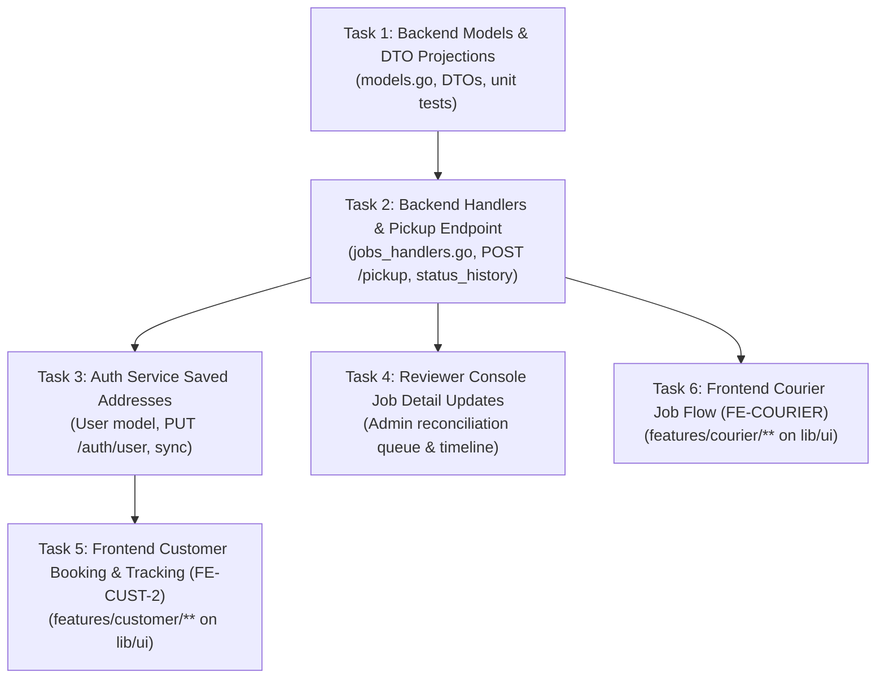

# ADR-0028: Job Model v2 (Recipient, Address Text, Status History, Pickup Phase, ETA, Saved Addresses)

- **Status**: Proposed
- **Date**: 2026-10-19 (Revised 2026-10-20)
- **Related**: ADR-0002 (Per-Job Escrow Integrity), ADR-0006 (Negotiable Transport Pricing), ADR-0007 (GPS Reconciliation), ADR-0008 (Live Employee Tracking), ADR-0009 (Atomic CAS Guards), ADR-0024 (Expired-Subscription Booking Gate), ADR-0025 (Working Hours Schedule), ADR-0027 (Employee Cancellation Request Workflow); FE-DS design system (`docs/design/DESIGN_SYSTEM.md`, `docs/worklog/FE-DS.md` §6); Redesign A mockups (`docs/design/redesign-a/00-SCREEN-MAP.html`, `A-Book.html`, `A-Track.html`, `A-Searching.html`, `A-Courier.html`)
- **Implementation Lane**: Documentation only (proposal). Code implementation will follow in sequential tasks: backend models & DTOs, endpoint updates, auth-service saved addresses, reviewer console, and modular frontend consumption (`frontend/lib/features/customer/**`, `frontend/lib/features/courier/**`).

---

## Context

The Quick Delivery platform's core trip/delivery entity (`models.Job`, `services/user-service/internal/models/models.go:139-175`) was designed during initial prototyping and iteratively patched across ADR-0002 through ADR-0027. While it supports basic dispatch, live GPS tracking, negotiable transport pricing, and employee cancellation requests, the modern mobile redesign ("Redesign A", `docs/design/redesign-a/00-SCREEN-MAP.html`) and design system audit (`docs/worklog/FE-DS.md` §6) revealed critical data gaps and architectural inconsistencies:

1. **Missing Recipient Entity**: In delivery jobs, the ordering customer is frequently not the package recipient (e.g. sending a gift, peer-to-peer delivery, merchant shipping). Today, `Job` only records `UserID` (`models.go:143`). Couriers have no recipient name or phone, forcing manual out-of-band communication or courier calls to the sender.
2. **Missing Textual Addresses**: `Location` (`models.go:126-133`) contains only `Latitude`, `Longitude`, and an optional `AddressNote` (landmark note, ≤ 500 runes). Neither pickup nor destination has a street address or district name. Screen mockups (`A-Book.html:43-57`, `A-Track.html:73-74`, `A-Courier.html:41-49`) require both structured address text and landmark notes.
3. **No Timeline / Transition History**: `Job` only stores `CreatedAt` and `UpdatedAt` (`models.go:173-174`), plus a few point-in-time timestamps (`CancellationRequestedAt`, `OfferExpiresAt`, `PriceProposalExpiresAt`). The UI timeline (`A-Track.html:53-70`) cannot render when a job was accepted, dispatched, or completed; clients are forced to guess from `UpdatedAt` or omit timestamps.
4. **Coarse "Active" State (Missing "Picked Up" Phase)**: In the backend, once a courier accepts an offer, `Status` immediately becomes `JobStatusActive = "active"` (`jobs_handlers.go:2010`) and remains active until `JobStatusCompleted = "completed"` (`jobs_handlers.go:782`). There is no operational step representing package collection or rider pickup. Couriers cannot signal that they have arrived at pickup or collected the goods, and customers cannot distinguish between a courier driving to pickup vs driving to delivery.
5. **No ETA / Duration Estimation**: The backend stores `BookedDistance` (`models.go:161`) internally, but does not expose it in `OwnerJobResponse` (`models.go:178-207`), `CustomerJobResponse` (`models.go:247-264`), or `EmployeeJobResponse` (`models.go:293-319`). No duration or ETA field exists.
6. **Inconsistencies & State Ghosts**:
   - `assigned` exists only in frontend (`frontend/lib/screens/customer_home_screen.dart:263`, `frontend/lib/ui/components/qd_status_chip.dart:48`), but does not exist in backend `models.JobStatus` (`models.go:99-107`).
   - `reconciliation_required` is used as an alias in frontend (`frontend/lib/utils/enum_labels.dart:18`, `qd_status_chip.dart:52`), while backend defines `escrow_reconciliation_required` (`models.go:106`).
   - `unavailable` (`models.go:101`) is treated as a terminal state during dispatch cascade exhaustion (`mongodb.go:835`). When a job is unavailable, dispatch has concluded and the customer re-books; `CancelJob` (`jobs_handlers.go:2905`) returns 409 Conflict because the job is already terminal.
7. **Saved Addresses Lack Coordinates**: `User.FrequentAddresses` (`services/auth-service/internal/models/models.go:60`) stores a list of plain strings (`[]string`, max 10 entries of ≤ 200 chars). Because they lack coordinates, customers picking a saved address in `A-Book.html` cannot trigger automatic pin placement or distance calculation without manual map re-selection.

### Constraints & Invariants (Owner Decisions)
- **Cash-on-Delivery (COD) Only**: Production runs on cash-on-delivery (`payment_method == "cod"`) until an external payment gateway is contracted (`jobs_handlers.go:254-261`). Wallet/escrow redesign (MONEY-A/B) is strictly out of scope. Existing escrow fields (`LockedEscrowAmount`, `ActualCashAmount`, `PaymentMethod`) must remain untouched and backward compatible.
- **Handover Codes Parked**: Handover verification will be added as an optional sub-document on `Job` when unparked. Delivery confirmation PINs / OTP codes are parked for future implementation; confirmation remains human (courier marks delivered; cash collected).
- **Single Flutter Client + Reviewer Console**: One unified Flutter application serves Customers, Couriers, and Business Owners; ops reviewers use the web reviewer console.

---

## Decision

### 1. Current State Lifecycle Analysis & Inconsistencies

#### 1.1 State Transition Diagram (Current Implementation)

```mermaid
stateDiagram-v2
    [*] --> pending: TrackJob (direct employee_id, transport proposed) [jobs_handlers.go:443]
    [*] --> pending_dispatch: TrackJob (cascade discovery) [jobs_handlers.go:508]
    [*] --> active: TrackJob (direct employee_id, non-transport) [jobs_handlers.go:514]

    pending_dispatch --> active: AcceptJobOffer (delivery/shipping) [jobs_handlers.go:2010]
    pending_dispatch --> awaiting_price_response: AcceptJobOffer (transport) [jobs_handlers.go:2009]
    pending_dispatch --> pending_dispatch: DeclineJobOffer (advanceCascade to next courier) [jobs_handlers.go:2571]
    pending_dispatch --> pending_dispatch: Sweep / Lazy Expiry (45s timeout -> next courier) [jobs_handlers.go:2656]
    pending_dispatch --> unavailable: advanceCascade (no available couriers left) [store/mongodb.go:835]
    pending_dispatch --> cancelled: CancelJob (owner/customer) [jobs_handlers.go:2862]

    awaiting_price_response --> active: RespondPrice (accept) [jobs_handlers.go:3778]
    awaiting_price_response --> cancelled: RespondPrice (customer decline) [jobs_handlers.go:3807]
    awaiting_price_response --> pending_dispatch: RespondPrice (courier decline -> unassign & re-dispatch) [jobs_handlers.go:3842]
    awaiting_price_response --> cancelled: checkLazyPriceProposalExpiry (15m timeout) [jobs_handlers.go:3512]
    awaiting_price_response --> cancelled: CancelJob (owner) [jobs_handlers.go:2862]

    active --> awaiting_price_response: ProposePrice (counter-offer during trip) [jobs_handlers.go:3622]
    active --> completed: CompleteJob (normal delivery / cod cash collected) [jobs_handlers.go:782]
    active --> escrow_reconciliation_required: CompleteJob (GPS under-distance check triggers) [jobs_handlers.go:756]
    active --> cancelled: CancelJob (owner only; customer blocked on active) [jobs_handlers.go:2912]

    active --> active: RequestCancellation (courier requests, status="pending") [jobs_handlers.go:3164]
    active --> cancelled: RespondCancellation (owner accepts) [jobs_handlers.go:3379]
    active --> active: RespondCancellation (owner rejects, status="rejected") [jobs_handlers.go:3430]
    active --> pending_dispatch: checkLazyCancellationRequestExpiry (15m timeout -> unassign & re-dispatch) [jobs_handlers.go:3033]

    escrow_reconciliation_required --> completed: ResolveReconciliation (decision="release_to_employee") [reconciliation_handlers.go:153]
    escrow_reconciliation_required --> cancelled: ResolveReconciliation (decision="refund_to_customer") [reconciliation_handlers.go:193]

    completed --> [*]
    cancelled --> [*]
    unavailable --> [*]
```



#### 1.2 Documented Inconsistencies in Current Code

| # | Inconsistency | Location in Code | Impact & Resolution |
|---|---|---|---|
| 1 | **Frontend-only `assigned` status** | `frontend/lib/screens/customer_home_screen.dart:263`, `frontend/lib/ui/components/qd_status_chip.dart:48` | The frontend checks `status == 'assigned'`, but backend `models.JobStatus` (`models.go:99-107`) has no such state. Backend transitions directly from `pending_dispatch` to `active` upon courier acceptance (`jobs_handlers.go:2010`). Frontend never actually encounters `"assigned"` from the API. **Resolution**: `sub_status = "heading_to_pickup"` under `status = "active"` cleanly represents this phase. |
| 2 | **Status Alias: `reconciliation_required` vs `escrow_reconciliation_required`** | Backend `models.go:106` defines `JobStatusEscrowReconciliationRequired = "escrow_reconciliation_required"`. Frontend `enum_labels.dart:18` and `qd_status_chip.dart:52` check both. | Frontend had to introduce fallback mapping. Backend string is authoritative. **Resolution**: Keep canonical `escrow_reconciliation_required` in backend; client DTOs map to unified UI chip `underReview`. |
| 3 | **`unavailable` Terminal State Handling** | Backend `mongodb.go:835` sets `JobStatusUnavailable`. `CancelJob` (`jobs_handlers.go:2905`) returns `409 Conflict: job is unavailable` when attempting to cancel. | `unavailable` is already a terminal state: cascade discovery has completed with no candidates, the job is listed as finished/unfilled in the UI, and the customer re-books. Nothing is stuck or running in the background. The 409 response from `CancelJob` merely reflects that the job is already closed, though clients expecting idempotent cancellation should treat 409 on unavailable as a successful no-op. |
| 4 | **Direct Assignment Path via Employee Credential** | `jobs_handlers.go:224-250` and `409-425`, `514` (`TrackJob` with `employee_id`) sets `status: JobStatusActive` immediately. | This path requires a valid employee bearer token (`resolveTokenWithRole(req.EmployeeID, "employee")`, line 225) and passes tenant binding validation (`verifyEmployeeAssignment`, line 237). Only someone presenting a valid token for an employee belonging to the owner's tenant (e.g. employee self-booking, or owner assigning via employee credential) can trigger it. It transitions directly to `active` because the courier's assignment is pre-agreed upfront. In v2, this path initializes `sub_status = "heading_to_pickup"` for lifecycle consistency. |
| 5 | **Distance Discrepancy Escrow Flag in Pure COD** | `jobs_handlers.go:756` pushes delivery jobs into `escrow_reconciliation_required` even when `payment_method == "cod"` and `locked_escrow_amount == 0`. | Admin ops queue (`AdminReconciliationJobItem`, `models.go:667-685`) is populated with jobs where no platform money is locked, creating operational confusion. **Resolution**: Clarify reconciliation status as dispute-oriented, not money-locking when COD. |
| 6 | **NEW: GPS Under-Distance Check Aborts COD Cash Recording** | `jobs_handlers.go:738-770` vs `782-805` in `CompleteJob`. | In `CompleteJob` for `delivery` and `shipping` categories, the GPS under-distance check (lines 738–770) executes *before* the COD processing branch (line 782). If tracked distance is < 70% of booked distance, the handler immediately updates the job to `escrow_reconciliation_required` (line 756) and returns early (line 769). Consequently, the courier's cash collection (`req.CashCollected`, `req.ActualCashAmount`) is never recorded in the database, and the job halts waiting for owner resolution, even though no platform funds are held. **Impact**: Courier cash reconciliation is blocked. **Note**: This is documented as a known flaw; the fix is scheduled under a separate task (`FIX-COD-RECON`), not part of v2. |

---

### 2. New Fields Specification

All new fields are strictly additive, optional on input, and backward compatible.

#### 2.1 Recipient Information (`recipient`)

Represents the designated dropoff recipient when different from or specified by the booking customer.

```go
type JobRecipient struct {
    Name  string `json:"name,omitempty"  bson:"name,omitempty"`
    Phone string `json:"phone,omitempty" bson:"phone,omitempty"`
    Notes string `json:"notes,omitempty" bson:"notes,omitempty"`
}
```

- **Type**: `JobRecipient` (embedded object in `Job`, field `recipient`).
- **Who Writes It**: The customer (or owner) on `POST /users/jobs/track` (`CreateJobRequest.Recipient`).
- **When**: At booking creation only. Recipient editing after job creation is omitted in v2.
- **Validation**:
  - `name`: String, 1–100 runes after trimming. Optional (defaults to customer username if omitted).
  - `phone`: String, optional. Validated against E.164 or Egyptian mobile format (`^(?:\+20|0)?1[0125][0-9]{8}$`), max 20 chars.
  - `notes`: String, optional, max 200 runes (e.g. "Leave with doorman").
- **Privacy & Exposure Boundary**:
  - `OwnerJobResponse`: Always exposed (owner sees full tenant operational data).
  - `CustomerJobResponse`: Always exposed to the booking customer.
  - `EmployeeJobResponse`: **Conditionally exposed**. Shown to the courier from acceptance (`heading_to_pickup`) until the job is completed or cancelled. Once the job transitions to terminal state (`completed`, `cancelled`, `unavailable`), `recipient.phone` is redacted (`""` or masked `***-****-1234`) to protect recipient privacy and prevent post-trip contact harvesting.

#### 2.2 Structured Address Text (`pickup_address` & `destination_address`)

Decouples human-readable address descriptions from coordinates and landmark notes.

```go
type Location struct {
    Latitude    float64 `json:"latitude"               bson:"latitude"`
    Longitude   float64 `json:"longitude"              bson:"longitude"`
    Address     string  `json:"address,omitempty"       bson:"address,omitempty"`       // New: structured text (street, area, city)
    AddressNote string  `json:"address_note,omitempty"  bson:"address_note,omitempty"`  // Existing: landmark note (Option C, <= 500 chars)
}
```

- **Type**: `string` field `Address` added to `models.Location` (`models.go:126-133`).
- **Who Writes It**: Customer or owner during `POST /users/jobs/track`.
- **How Address Text Gets There (Zero Geocoding Cost)**:
  - The platform does **not** invoke paid reverse-geocoding APIs (Google Geocoding, Mapbox).
  - **Source 1 (Customer Selection)**: In `A-Book.html`, customer selects a saved address (`SavedAddress.Address`) or manually types the street name / building description in the address input field.
  - **Source 2 (Service Origin Default)**: If pickup is at the merchant's location, the system defaults `location.address` from `Service.Address` (`models.go:42`).
  - **Source 3 (Fallback)**: If omitted, `address` is empty and UI falls back to `address_note` or formatted coordinates (`JobLocation.addressSummary()`, `frontend/lib/models/job.dart:25-29`).
- **Validation**: Max 250 runes, trimmed. Sanitized against control characters.
- **Privacy**: Unrestricted across all role DTOs for participants of the job.

#### 2.3 Status Transition History (`status_history`)

Provides an append-only timeline of every state transition, recording exact timestamps, actors, and reasons.

```go
type JobStatusHistoryEntry struct {
    Status    JobStatus `json:"status"                bson:"status"`
    SubStatus string    `json:"sub_status,omitempty"  bson:"sub_status,omitempty"`
    At        time.Time `json:"at"                    bson:"at"`
    ActorRole string    `json:"actor_role"           bson:"actor_role"` // "customer" | "employee" | "owner" | "system" | "admin"
    ActorID   string    `json:"actor_id,omitempty"    bson:"actor_id,omitempty"`
    Reason    string    `json:"reason,omitempty"      bson:"reason,omitempty"`
}
```

- **Type**: `[]JobStatusHistoryEntry` on `models.Job` (`bson:"status_history"`).
- **Who Writes It**: The backend store atomically appends via MongoDB `$push` on **every** status transition.
- **When**:
  - Initial creation (`TrackJob`): `status="pending"` or `"pending_dispatch"`, `actor_role="customer"`.
  - Offer acceptance (`AcceptJobOffer`): `status="active"`, `sub_status="heading_to_pickup"`, `actor_role="employee"`.
  - Pickup confirmation (`POST /users/jobs/pickup`): `status="active"`, `sub_status="picked_up"`, `actor_role="employee"`.
  - Price proposal / response: records proposal / agreed price transition.
  - Completion (`CompleteJob`): `status="completed"`, `actor_role="employee"` or `"owner"`.
  - Cancellation / Expiry: records reason and cancelling party.
- **Validation**: Server-generated only. Never accepted from client input.
- **Privacy**: `ActorID` is included for audit in `OwnerJobResponse` and Admin console. In `CustomerJobResponse` and `EmployeeJobResponse`, `ActorID` is sanitized/omitted if the actor is an internal admin reviewer or system process.

#### 2.4 Picked-Up Step: Umbrella Active State with `sub_status`

- **Decision**: Keep `JobStatus = "active"` as the umbrella top-level status to prevent breaking existing MongoDB queries, lock guards, and external consumers. Introduce an explicit `sub_status` field (`Job.SubStatus`):
  - Defined **ONLY** when `status == "active"`.
  - Valid values:
    - `"heading_to_pickup"`: Courier accepted the offer, navigating to origin.
    - `"picked_up"`: Goods collected / passenger onboard, navigating to dropoff destination.
  - When `status != "active"`, `sub_status` is empty/omitted.
  - Legacy active jobs without `sub_status`: treated as unknown/unspecified. The UI shows plain "active" without guessing a phase.
- **Rationale**:
  - Over 25 MongoDB update filters in `store/mongodb.go` filter specifically on `"status": "active"` (e.g. `UpdateJobLocation`, `RefundEscrow`, `RollbackEscrow`, `CompleteJob`).
  - `sub_status` preserves 100% backward compatibility for all legacy queries while giving the Flutter UI the exact granular states needed for `A-Track.html` and `A-Courier.html`.
- **How Courier Marks It**:
  - New dedicated endpoint: `POST /users/jobs/pickup`.
  - Caller must resolve to role `employee` and match `job.EmployeeID`.
  - Job status must be `active` and `sub_status` must be `"heading_to_pickup"`.
  - Updates `sub_status = "picked_up"` and appends to `status_history`.
  - Broadcasts SSE event `job_picked_up` to customer.

#### 2.5 Estimated Time of Arrival (ETA)

- **Decision**: **Client-side straight-line estimate with urban buffer + optional server duration snapshot on assignment**.
- **Justification & Cost Analysis**:
  - The project operates under zero-paid-API constraints (no Google Directions API, no Mapbox Navigation subscription, no paid matrix endpoints).
  - High ping frequency: Courier availability heartbeat is ~60 s (when online without an active job), and active job location tracking sends pings every ~3.5 s (minimum interval gate) / 10 m distance filter (`frontend/lib/providers/employee_location_provider.dart:174, 208, 228`). Calling an external routing API on every courier ping would cost thousands of dollars per month and degrade the location ingestion loop.
  - Egyptian urban traffic exhibits extreme variance where standard straight-line calculations without live traffic are approximate.
- **Design**:
  - **Server-side**: When courier is assigned (`AcceptJobOffer`) and when pickup is confirmed (`POST /users/jobs/pickup`), backend calculates straight-line distance $D$ (Haversine) from courier to target, computes `estimated_duration_minutes = ceil(D_km / 20.0 * 60) + 3` (assuming 20 km/h average motorcycle city speed + 3 min buffer), and stores `EstimatedDurationMinutes *int` on `Job`.
  - **Client-side (Flutter)**: During live tracking (`A-Track.html`), Flutter client reads `current_location` from SSE/polling and target coordinates, displaying a friendly approximate range ("10–15 دقيقة") using `QdCountdown` / formatted duration.

#### 2.6 Courier Contact Exposed to Customer

- **Decision**: **In-app chat as primary + conditional phone exposure during active trip only**.
- **Privacy Analysis & Policy**:
  - In-app chat via `services/chat-service` is already fully operational (WebSocket/HTTP pub/sub) and is the primary communication medium.
  - Couriers navigating traffic on motorcycles cannot safely type messages; direct phone calls are an operational necessity in Egyptian delivery.
  - **Window**: `CustomerJobResponse` exposes `courier_phone` from acceptance (`heading_to_pickup`) until the job is completed or cancelled. Once completed or cancelled, `courier_phone` is set to `""`.
  - This mirrors the exact privacy window used for showing `recipient.phone` to the courier.

#### 2.7 Package Details: Size & Notes

- **Decision**: **IN (Included in v2)**.
- **Specification**:
  ```go
  type PackageDetails struct {
      Size  string `json:"size,omitempty"  bson:"size,omitempty"`  // "small" | "medium" | "large"
      Notes string `json:"notes,omitempty" bson:"notes,omitempty"` // e.g. "Fragile glassware, handle with care"
  }
  ```
- **Rationale & Validation**:
  - Informational capacity signal only; **no pricing effect**.
  - `size` is optional at booking, **default empty (not specified / unset)** in backend. The UI may preselect an option, but the backend does not invent one.
  - Allowed values if provided: `"small"`, `"medium"`, `"large"`.
  - `notes`: String, optional, max 200 runes.

#### 2.8 Saved Addresses with Coordinates (`SavedAddress`)

- **Current State**: `services/auth-service/internal/models/models.go:60` stores `FrequentAddresses []string` (strings only).
- **New Specification**:
  ```go
  type SavedAddress struct {
      ID          string  `json:"id"                     bson:"id"`
      Label       string  `json:"label"                  bson:"label"`        // "البيت", "الشغل", "مخزن"
      Address     string  `json:"address"                bson:"address"`      // Street / building
      AddressNote string  `json:"address_note,omitempty" bson:"address_note,omitempty"` // Landmark note
      Latitude    float64 `json:"latitude"               bson:"latitude"`
      Longitude   float64 `json:"longitude"              bson:"longitude"`
  }
  ```
- **Storage & Migration**:
  - Add `SavedAddresses []SavedAddress` to `User` struct in `services/auth-service/internal/models/models.go`.
  - Max 10 saved addresses per user.
  - **Address Immutability**: Jobs snapshot address and coordinates at booking creation time; subsequent profile updates or address deletions never touch historical or active job records.
  - **Backward Compatibility**: `FrequentAddresses []string` is preserved in parallel. When `PUT /auth/user` receives `saved_addresses`, it synchronizes `FrequentAddresses` with the address strings for legacy clients.

#### 2.9 Owner Decisions on Key Architecture Choices

1. **Courier & Recipient Phone Window**: Symmetrically exposed from offer acceptance (`sub_status: "heading_to_pickup"`) until the job reaches a terminal state (`completed` or `cancelled`). Hidden / redacted immediately thereafter.
2. **Package Size Behavior**: Informational only with zero price multiplier effect. Optional at booking with empty/unset backend default.
3. **Service Category Terminology**: Generic backend tokens (`heading_to_pickup`, `picked_up`) stored in database and emitted via API; localized contextually per service category (`delivery`, `transport`, `shipping`) in Flutter ARB files.
4. **Migration Strategy**: Strictly lazy on-read. No synthetic entries generated for legacy jobs.
5. **Address Immutability**: Address data is snapshotted into `Job.Location` upon creation; profile edits never cascade to jobs.
6. **Handover Verification Codes**: Parked. Handover verification will be added as an optional sub-document on `Job` when unparked. No placeholder fields in v2.

---

### 3. API Contract Changes per Endpoint

All request body additions are optional. All response body additions are non-breaking.

#### 3.1 `POST /users/jobs/track` (Create Job)

##### Request JSON Diff
```diff
 {
   "service_id": "svc-delivery-1",
   "location": {
     "latitude": 30.0444,
     "longitude": 31.2357,
+    "address": "15 شارع قصر النيل، وسط البلد",
     "address_note": "الدور الثالث، شقة 5"
   },
   "destination": {
     "latitude": 30.0600,
     "longitude": 31.2200,
+    "address": "4 شارع التحرير، الدقي",
     "address_note": "بجوار مترو الدقي"
   },
-  "payment_method": "cash",
+  "payment_method": "cod",
+  "recipient": {
+    "name": "محمود إبراهيم",
+    "phone": "+201012345678",
+    "notes": "يرجى الاتصال قبل الوصول"
+  },
+  "package_details": {
+    "size": "small",
+    "notes": "أوراق ومستندات هامة"
+  }
 }
```

##### Response JSON Diff (`CustomerJobResponse`)
```diff
 {
   "id": "job-123",
   "status": "pending_dispatch",
   "location": {
     "latitude": 30.0444,
     "longitude": 31.2357,
+    "address": "15 شارع قصر النيل، وسط البلد",
     "address_note": "الدور الثالث، شقة 5"
   },
   "destination": {
     "latitude": 30.0600,
     "longitude": 31.2200,
+    "address": "4 شارع التحرير، الدقي",
     "address_note": "بجوار مترو الدقي"
   },
+  "recipient": {
+    "name": "محمود إبراهيم",
+    "phone": "+201012345678",
+    "notes": "يرجى الاتصال قبل الوصول"
+  },
+  "package_details": {
+    "size": "small",
+    "notes": "أوراق ومستندات هامة"
+  },
+  "status_history": [
+    {
+      "status": "pending_dispatch",
+      "at": "2026-10-19T16:00:00Z",
+      "actor_role": "customer"
+    }
+  ],
   "created_at": "2026-10-19T16:00:00Z"
 }
```
*(Note: `sub_status` is omitted for `pending_dispatch` as it is defined strictly when `status == "active"`).*

#### 3.2 `POST /users/jobs/pickup` (New Endpoint: Mark Picked Up)

- **Route**: `POST /users/jobs/pickup`
- **Auth**: Courier token (`Bearer <jwt>` or `RequesterToken` with role `employee`).
- **Request Body**:
  ```json
  {
    "job_id": "job-123",
    "notes": "استلمت الشحنة بنجاح من الراسل"
  }
  ```
- **Validation Rules**:
  - Caller must be assigned employee (`job.EmployeeID == caller.ID`).
  - Job status must be `active`.
  - Job `sub_status` must be `"heading_to_pickup"`. If already `"picked_up"`, returns 409 `already_picked_up`.
- **Response Body**: Returns updated `EmployeeJobResponse` with `sub_status: "picked_up"` and appended `status_history`.

#### 3.3 `POST /users/jobs/complete` (Complete Job)

##### Request Body (Unchanged)
```json
{
  "job_id": "job-123",
  "cash_collected": true,
  "actual_cash_amount": 75.0
}
```

##### Response Body (`EmployeeJobResponse` / `OwnerJobResponse`)
```diff
 {
   "id": "job-123",
   "status": "completed",
+  "status_history": [
+    {"status": "pending_dispatch", "at": "2026-10-19T16:00:00Z", "actor_role": "customer"},
+    {"status": "active", "sub_status": "heading_to_pickup", "at": "2026-10-19T16:01:10Z", "actor_role": "employee"},
+    {"status": "active", "sub_status": "picked_up", "at": "2026-10-19T16:15:30Z", "actor_role": "employee"},
+    {"status": "completed", "at": "2026-10-19T16:32:00Z", "actor_role": "employee"}
+  ],
   "updated_at": "2026-10-19T16:32:00Z"
 }
```
*(Note: `sub_status` is omitted upon completion).*

#### 3.4 `GET /users/jobs/{id}` Role DTO Differences

| Field | `CustomerJobResponse` | `EmployeeJobResponse` | `OwnerJobResponse` |
|---|---|---|---|
| `recipient.name` | Yes | Yes (from acceptance to completion) | Yes |
| `recipient.phone` | Yes | Yes (strictly from acceptance to completion) | Yes |
| `courier_phone` | Yes (strictly from acceptance to completion) | N/A (self) | Yes |
| `sub_status` | Yes (only when `status == "active"`) | Yes (only when `status == "active"`) | Yes (only when `status == "active"`) |
| `status_history` | Yes (actor IDs sanitized) | Yes (actor IDs sanitized) | Yes (full audit IDs) |
| `package_details` | Yes | Yes | Yes |
| `estimated_duration_minutes` | Yes | Yes | Yes |

#### 3.5 `PUT /auth/user` (Saved Addresses)

##### Request JSON Diff
```diff
 {
   "username": "ahmed_customer",
   "phone": "+201099998888",
+  "saved_addresses": [
+    {
+      "id": "addr-home-1",
+      "label": "البيت",
+      "address": "15 شارع قصر النيل، وسط البلد",
+      "address_note": "الدور الثالث، شقة 5",
+      "latitude": 30.0444,
+      "longitude": 31.2357
+    },
+    {
+      "id": "addr-work-2",
+      "label": "الشغل",
+      "address": "قرية التكنولوجيا، المعادي",
+      "address_note": "مبنى B2",
+      "latitude": 29.9602,
+      "longitude": 31.2564
+    }
+  ]
 }
```

---

### 4. Database Migration & Indexes

#### 4.1 Non-Destructive Lazy-Only Migration Strategy
Existing MongoDB `jobs` collection documents lack the new fields.
- **Zero Downtime**: MongoDB schemas are flexible. Unset fields simply deserialize into Go zero-values (`nil`, `""`, empty slice).
- **Lazy On-Read Defaulting (No Backfill Script)**:
  - Migration is **strictly lazy**. No one-off background migration script is used, and no artificial entries are synthesized.
  - Legacy historical jobs have an empty `status_history: []` (or omitted), and client UIs display only `created_at` for them.
  - If `recipient` is absent, DTO constructors fall back to customer username and phone.
  - Legacy active jobs lacking `sub_status` are treated as unknown/unspecified; the UI displays plain "active" without guessing.

#### 4.2 MongoDB Indexes

##### Existing Indexes on `jobs` Collection
Initialized in `services/user-service/internal/store/mongodb.go:104-138`:
1. `{ "owner_id": 1 }`
2. `{ "user_id": 1 }`
3. `{ "employee_id": 1 }`
4. `{ "service_id": 1 }`
5. `{ "owner_id": 1, "status": 1 }`
6. `{ "current_offered_employee_id": 1 }`
7. `{ "status": 1, "offer_expires_at": 1 }`

##### Proposed Missing Indexes
Only composite indexes that optimize v2 query patterns and are not covered by existing indexes are proposed:
```javascript
// Compound index for customer active and history queries (existing is only user_id: 1)
db.jobs.createIndex({ "user_id": 1, "status": 1, "created_at": -1 });

// Compound index for courier active job lookups with sub-status (existing is only employee_id: 1)
db.jobs.createIndex({ "employee_id": 1, "status": 1, "sub_status": 1 });

// Compound index for owner fleet monitoring with creation date sort (existing is only owner_id: 1, status: 1)
db.jobs.createIndex({ "owner_id": 1, "status": 1, "created_at": -1 });
```

---

### 5. Rollout Plan (Small Sequential Tasks)

The rollout is divided into independent, incremental pull requests. The backend changes are purely additive and require no feature flags.



#### Task 1: Backend Model Definitions & DTO Extensions
- **Scope**: `services/user-service/internal/models/models.go`, DTO constructors.
- **Deliverables**: Add `JobRecipient`, `PackageDetails`, `JobStatusHistoryEntry`, and `SubStatus` to `Job`. Update `NewOwnerJobResponse`, `NewCustomerJobResponse`, and `NewEmployeeJobResponse` with symmetric phone redaction outside the active window.
- **Tests**: Unit tests for DTO projections asserting privacy redaction for completed jobs.

#### Task 2: Backend Handlers & Status History Integration
- **Scope**: `services/user-service/internal/handlers/jobs_handlers.go`, `store/mongodb.go`.
- **Deliverables**: Register `POST /users/jobs/pickup`. Update `TrackJob`, `AcceptJobOffer`, `ProposePrice`, `RespondPrice`, `CompleteJob`, `CancelJob`, and `RespondCancellation` to `$push` to `status_history`.
- **Tests**: Handler integration tests testing the full lifecycle.

#### Task 3: Auth-Service Structured Saved Addresses
- **Scope**: `services/auth-service/internal/models/models.go`, `services/auth-service/internal/handlers/auth.go`.
- **Deliverables**: Add `SavedAddress` struct; update `PUT /auth/user` validation (max 10 addresses, coordinate validation); synchronize legacy `frequent_addresses`.
- **Tests**: Auth handler unit and integration tests.

#### Task 4: Reviewer Console Timeline Inspection
- **Scope**: `services/user-service/internal/handlers/reconciliation_handlers.go`, Reviewer Console UI.
- **Deliverables**: Include `status_history`, recipient details, and package notes in `AdminReconciliationJobItem` for ops dispute resolution.

#### Task 5: Frontend Customer Booking & Live Tracking (FE-CUST-2)
- **Scope**: `frontend/lib/features/customer/**` built on `frontend/lib/ui/**` (not deprecated `screens/`).
- **Deliverables**: Wire `A-Book.html` recipient and address inputs; display 4-stage `QdTimeline` on `A-Track.html`.

#### Task 6: Frontend Courier Experience (FE-COURIER)
- **Scope**: `frontend/lib/features/courier/**` built on `frontend/lib/ui/**` (not deprecated `screens/`).
- **Deliverables**: Add "استلمت الطلب" (Confirm Pickup) button calling `POST /users/jobs/pickup`; display recipient contact card during ongoing task.

---

### 6. Alternatives Considered & Rejected

1. **Splitting `JobStatus` into Top-Level `heading_to_pickup`, `picked_up`, `heading_to_dropoff`**:
   - *Rejected*: Over 25 queries in `mongodb.go` filter on `status: "active"` (escrow locking, courier ping updates, location streaming, rollback logic). Breaking `active` into multiple top-level statuses would create severe regression risks across the payment and cancellation systems. Umbrella status `active` with `sub_status` delivers identical UI capability with zero backend query regression.
2. **Third-Party Paid Routing API for Real-Time ETAs**:
   - *Rejected*: Violates the zero-paid-API cost constraint. External calls on every courier location ping (~3.5 s interval) would degrade performance and incur substantial API billing. Client-side straight-line estimation with traffic padding provides sufficient user expectation setting for local delivery.
3. **Telephony Number Masking (e.g. Twilio Proxy)**:
   - *Rejected*: Involves significant foreign-currency recurring costs per minute and complex local telco routing in Egypt. In-app chat via `chat-service` is the free, secure, primary medium; conditional phone exposure during active tasks balances operational safety with privacy.
4. **Keeping `FrequentAddresses` as Plain Strings**:
   - *Rejected*: Forces customers to re-navigate the map sheet every time they book a delivery to their home or workplace. Coordinates are necessary for 1-tap booking in `A-Book.html`.
5. **Separate Recipient User Accounts**:
   - *Rejected*: Creating full `User` accounts for delivery recipients adds unnecessary database bloat, KYC/password friction, and SMS OTP verification costs. An embedded value-object (`JobRecipient`) on the job is sufficient.

---

### 7. Open Questions for the Owner

All 6 previous architectural questions have been resolved by owner decisions (documented in §2.9).
- **Remaining Open Questions**: None. The specification is complete and ready for adoption upon review.

---

## Consequences

### Positive
- Closes all data gaps identified in `FE-DS.md` and `00-SCREEN-MAP.html`.
- Enables rich, accurate progress timelines (`A-Track.html`) without guessing from `updated_at`.
- Preserves 100% backward compatibility for all existing mobile builds and backend queries.
- Incurs zero third-party recurring API fees (no paid geocoding or routing APIs).
- Protects recipient and courier privacy with symmetric conditional redactions post-delivery.

### Negative / Trade-Offs
- `Job` struct gains additional fields, slightly increasing MongoDB document size (~300 bytes per active document).
- Couriers have an additional tap required ("استلمت الطلب") before delivery completion, requiring clear UI affordance on `A-Courier.html`.
